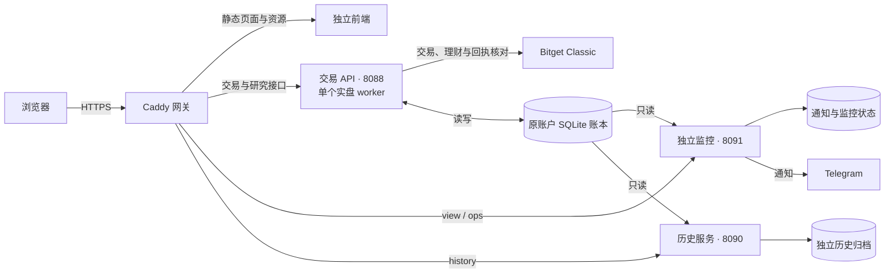
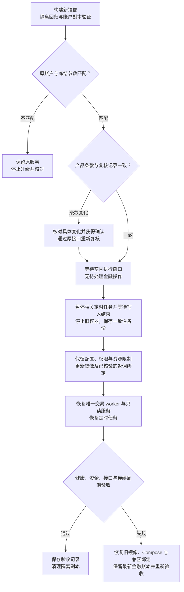

# QS TRX Server

TRX 策略专用后端，包含 Bitget 现货实盘执行、独立批次账本、研究回放、账户与理财到账核对、只读监控、Telegram 通知和在线备份。

仓库仅保留 TRX 功能及其依赖。Python 模块继续使用 `freqtrade.strategy.trx_phase1` 和 `freqtrade.rpc.api_server` 路径，以兼容已有部署脚本和保存任务；不再包含 Freqtrade 通用机器人、其他交易所、FreqAI、Hyperopt 或旧原生策略适配器。

## 服务架构

前端独立构建，通过同一 HTTPS 网关访问三个后端服务。只有交易服务持有交易凭证并运行实盘 worker；监控与历史服务只读访问账户账本，分别保存自己的通知状态与历史归档。



| 角色 | 线上容器 | 配置文件（容器内） | 内存 / CPU 上限 |
| --- | --- | --- | --- |
| 交易及研究 API | `trx-phase1-live` | `/app/user_data/config.cloud-web.json` | 2 GiB / 1.5 CPU |
| 只读监控 | `trx-phase1-observer` | `/config/observer.json` | 512 MiB / 0.25 CPU |
| 只读历史 | `trx-phase1-history` | `/config/history.json` | 256 MiB / 0.5 CPU |

宿主机另外运行在线备份、返佣自动入账和交易容器资源采集任务。资源采集通过容器名识别新实例，监控容器无需挂载 Docker socket。

### API 路由与鉴权

| 接口 | 服务及容器内端口 |
| --- | --- |
| `/api/v1/trx/live/view`、`/api/v1/trx/live/ops` | 独立监控，8091 |
| `/api/v1/trx/live/history` | 独立历史，8090 |
| 其他 `/api/v1/*` | 交易及研究 API，8088 |

三个服务使用同一网站 `username` 和 `jwt_secret_key`。`GET /api/v1/ping` 是公开健康检查；`POST /api/v1/token/login` 使用 HTTP Basic 返回 access/refresh token，`POST /api/v1/token/refresh` 刷新访问令牌。交易及研究接口接受 HTTP Basic 或 access token，独立监控与历史接口使用 access token。接口文档默认关闭，可设置 `api_server.enable_openapi: true` 后查看 `/docs`。

## 最近一次生产部署

以下为 **2026-10-20 12:18（UTC+8）** 的验收记录，实时状态通过下文运维检查确认。

| 项目 | 本次记录 |
| --- | --- |
| 部署源码 | [`dc3bd1134`](https://github.com/Quantitative-Strategies/qs-trx-server/commit/dc3bd1134c601f940d2ef1a75f402a71a96f640f) |
| 镜像 | `qs-trx-server:dc3bd1134-prod-20261020`（服务器本地构建标签） |
| 运行环境 | Linux x86_64、Python 3.13.16；交易依赖沿用升级前线上版本 |
| 替换范围 | 交易、监控、历史三个后端容器；前端与 Caddy 保持原样 |
| 容器状态 | 三个容器均健康，重启计数为 0，无 OOM |
| 实盘恢复 | 单个 worker，`desired=running`、`phase=observing`，无策略或执行错误 |
| 账户与资金 | 原账户、冻结参数、本金锚点、成交回执、增资及历史记录保留；首次建仓仍只有一次 |
| 在线验证 | 七轮连续采样，心跳、分钟线与收益对账持续推进；资金位置和净值归因一致 |
| 接口与前端 | 健康、实盘、监控、历史、研究配置接口返回 200；受保护接口拒绝未登录访问；前端页面及 10 个静态资源校验通过 |
| 运维任务 | 返佣自动入账、备份和资源采集正常，原有定时任务恢复 |

回归验证覆盖 648 个不同用例，另有 2 项因原始研究归档缺失而跳过。两轮全量回归中出现的短暂 SQLite 读锁和隔离临时盘容量限制，已通过真实磁盘上的针对性复测核验；没有遗留未解决的失败用例。

本次验收期间没有触发新成交，也没有强制发送测试订单；验证覆盖模拟交易、已有实盘账户恢复及在线行情和对账周期。重启时有 1 条恢复通知的发送回执未确认，保留原记录且不自动重发；新容器之后的通知已成功送达。

产品条款复核时，TRX 活期年化为 9.55%，处于用户仅为本次部署确认的 9.50%–9.60% 范围内，其余条款保持一致。该范围是本次部署记录，不是后续自动接受条款变化的永久配置，现有条款保护继续生效。

本次回滚资料及验收记录保留在服务器 `/opt/trx-phase1/backups/backend-dc3bd1134-20261020/`，其中 `acceptance.json` 为验收结果。配置、凭证、账户数据库和私有部署证据均不提交 Git。

## 本地运行

需要 Python 3.12 或更新版本：

```bash
python3 -m venv .venv
.venv/bin/python -m pip install -e '.[dev]'
mkdir -p user_data
cp config_examples/server.example.json user_data/config.trx.json
```

在本地配置文件的 `api_server` 中填写 `username`、`password` 和至少 32 字符的随机 `jwt_secret_key`，也可通过 `TRX_API_USERNAME`、`TRX_API_PASSWORD`、`TRX_API_JWT_SECRET_KEY` 覆盖。配置文件、账户凭证、SQLite 账本和运行数据均不进入 Git。

```bash
.venv/bin/trx-server --config user_data/config.trx.json
```

配置示例监听 `0.0.0.0:8088`；本机专用时可改为 `127.0.0.1`。生产环境使用 HTTPS 反向代理；前后端跨域时，在 `CORS_origins` 中填写实际前端来源。

默认 `existing_live_only: true`、`auto_resume_live: false`。首次启动不会自动创建或启动实盘账户。实盘准备、复核和启动继续使用原有 TRX 接口与 review hash 流程。交易进程只运行一个 worker；不要并行启动多个实例操作同一账户。

## Docker 与生产配置

### 本地单服务示例

先准备上述配置和 `user_data` 目录，并将其写入权限授予容器 UID 10001。设置三个 `TRX_API_*` 环境变量后运行：

```bash
docker compose up --build -d
```

仓库中的 `docker-compose.yml` 提供本地交易 API 示例，交易进程监听 `8088`，只在宿主机 `127.0.0.1:8088` 发布。容器内存及 memory+swap 上限均为 512 MiB。线上沿用三个独立 Compose 文件、既有数据挂载和上方列出的资源限制；本地示例不包含完整生产部署。

### 线上服务入口

交易容器兼容原启动命令：

```bash
freqtrade webserver --config /app/user_data/config.cloud-web.json --userdir /app/user_data --logfile /app/user_data/logs/webserver.cloud.log
```

`freqtrade` 是 TRX 服务的兼容命令名，接受 `webserver`；日志按大小轮换。监控与历史服务的入口分别为：

```bash
PYTHONPATH=/app/freqtrade/strategy python -m trx_phase1.live_ops_app
python /app/freqtrade/strategy/trx_phase1/live_history_app.py --config /config/history.json
```

三个角色复用同一镜像，生产 Compose 分别显式设置 `entrypoint`、`command` 和 `healthcheck`。新镜像默认入口是 `trx-server`，监控与历史角色需要各自的入口；健康检查也由 Compose 显式保留。

| 宿主机位置 | 用途 |
| --- | --- |
| `/opt/trx-phase1/compose.yaml` | 交易服务，Compose 项目 `trx-phase1`、服务 `trx` |
| `/opt/trx-phase1/observer-compose.yaml` | 监控服务，Compose 项目 `trx-observer`、服务 `observer` |
| `/opt/trx-phase1/history-compose.yaml` | 历史服务，Compose 项目 `trx-history`、服务 `history` |
| `/opt/trx-phase1/user_data/` | 持久化配置、账户与策略数据 |
| `/opt/trx-phase1/observer/state/` | 监控和通知数据库 |
| `/opt/trx-phase1/history/data/` | 独立历史归档 |

已有登录凭证、JWT 密钥、数据目录与冻结账户继续沿用。线上配置启用 `existing_live_only: true`、`auto_resume_live: true`，只恢复已有且已完成首次建仓的运行账户，不重新分配首仓。账户目录在监控和历史容器中保持只读挂载，各自的状态目录可写。

## 后端升级与回滚



1. **核对与预演。** 固定发布镜像及依赖版本，记录账户绑定、冻结参数、首次建仓 ID、历史成交和回执；使用隔离副本验证恢复与接口。副本测试关闭自动恢复并隔离网络，不连接真实交易写入。
2. **复核产品条款。** `review_hash` 包含账户设置、策略来源、手续费和产品条款。变化时先核对具体差异并获得确认，再通过已有账户的准备和启动接口完成复核；不手工改写指纹或绕过保护。暂停后等待 worker 停止，保留已完成的首次建仓记录。
3. **选择切换窗口。** 核实策略正常运行、已完成首次建仓、没有待处理意图或金融操作，并给下一次确认留足时间；本次切换要求间隔大于 300 秒。核对通知 outbox，等待在途发送结束，保留结果不明的记录。
4. **备份与替换。** 暂停返佣和备份定时任务，等待正在运行的任务结束；先停止只读服务，再正常停止交易服务。使用 SQLite online backup 保存一致性副本，备份 Compose、控制文件和返佣策略，保留旧镜像。沿用数据挂载、只读权限、启动命令、健康检查和资源限制。
5. **恢复返佣绑定。** 返佣自动入账校验 `worker_image_id` 与 `worker_module_sha256`。确认执行代码兼容后更新镜像绑定，保留原授权范围、审批时间和记账起点；执行代码哈希变化时需完成对应兼容复核与必要授权。
6. **恢复并验收。** 先恢复唯一交易 worker，再启动历史和监控服务，恢复原定时任务。验证心跳、已确认分钟线和收益对账持续更新，资金归因一致、历史记录完整、接口鉴权和前端功能正常；容器健康检查通过后仍须检查策略状态。

回滚恢复旧镜像、Compose 和对应的返佣兼容绑定，继续使用最新的真实账本。**回滚镜像时不自动恢复旧金融数据库**，避免覆盖升级期间已经发生的真实成交或到账。手动暂停与条款审核阻断继续保留。

后端清理且接口契约、登录和路由保持兼容时，前端沿用现有静态资源。本次升级已验证前端兼容，因此只替换后端容器；未来前端代码、构建配置或接口契约变化时需另行构建与部署。

## 日常检查

以下命令在生产宿主机执行，均为只读检查：

```bash
sudo docker inspect --format '{{.Name}} {{.State.Status}} {{.State.Health.Status}}' \
  trx-phase1-live trx-phase1-observer trx-phase1-history
curl --fail --silent --show-error http://127.0.0.1:8088/api/v1/ping
systemctl is-active trx-phase1-backup.timer \
  trx-phase1-rebate-capital.timer trx-phase1-resources.timer
```

交易 API 监听 `8088`。登录后通过 `/api/v1/trx/live` 检查 `runtime` 中的 `worker_running`、`desired`、`phase` 和错误字段；通过只读监控与历史接口核对心跳、分钟线、资金位置、收益对账、告警及历史记录。历史查询需携带当前账户的 `account_id`。

| 现象 | 检查与处理 |
| --- | --- |
| 容器健康但策略未运行 | 检查运行意愿、暂停状态、凭证绑定、冻结快照与条款复核结果 |
| `live_terms_changed_review_required` | 核对实际条款差异，完成确认与新一轮复核，保留原账户和首仓 |
| `worker_compatibility_changed` | 核对返佣策略的镜像 ID 与执行模块哈希，以及升级时的兼容绑定 |
| `telegram_delivery_unconfirmed` | 保留通知与尝试记录；结果不明时不自动重发，不修改交易账本 |

## 研究与运维

本地历史回放使用 Bitget TRX/USDT 一分钟 Feather 行情：

```bash
.venv/bin/trx-replay --data user_data/data/bitget/TRX_USDT-1m.feather
```

独立监控、历史读取、备份和恢复工具仍位于 `freqtrade/strategy/trx_phase1`。监控可继续使用 `PYTHONPATH=freqtrade/strategy python -m trx_phase1.live_ops_app` 启动，不加载交易执行客户端。详细边界见 [TRX 策略与运维说明](docs/trx-phase1.md)。

## 验证

```bash
.venv/bin/python -m pytest
.venv/bin/ruff check freqtrade tests
```

测试使用隔离的临时账户及模拟交易所，不提交真实订单。两个历史归档研究测试依赖未纳入版本控制的原始实验包，缺失时明确跳过。

本项目从 Freqtrade 的 TRX 定制实现提取，保留原 [GPLv3 许可证](LICENSE)。
